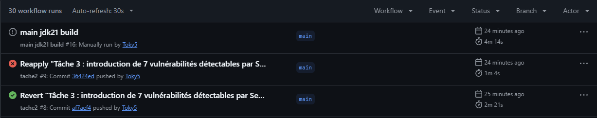
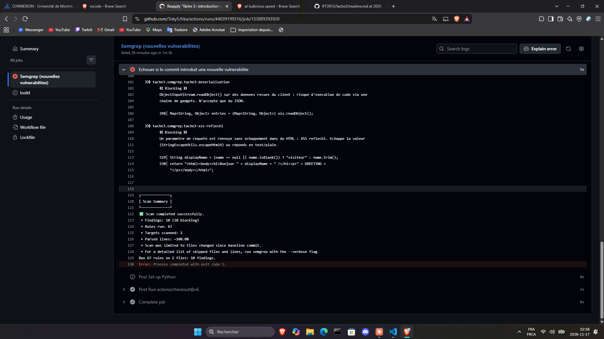

# IFT3913 : Tâche 3, Semgrep dans Apache Tika

<p align="center">
  <a href="https://github.com/semgrep/semgrep">
    
  </a>
</p>
<h3 align="center">« Code scanning at ludicrous speed. »</h3>
<p align="center"><em>Le slogan et le logo du dépôt open source de Semgrep (voir les crédits)</em></p>

**Équipe :** Toky Erick Rabenantoandro, Luc Brennan

## 1. Les fichiers modifiés et leur fonctionnement

Nous avons modifié deux classes Java de Tika, ajouté un fichier de règles Semgrep, modifié le workflow et écrit une petite action GitHub. Les deux classes ont été choisies parce que ce sont deux portes d'entrée de Tika sur le réseau.

### TikaResource.java

[`tika-server/tika-server-core/src/main/java/org/apache/tika/server/core/resource/TikaResource.java`](tika-server/tika-server-core/src/main/java/org/apache/tika/server/core/resource/TikaResource.java)

C'est la ressource JAX-RS qui répond aux requêtes envoyées à `/tika` sur tika-server. Elle reçoit un document et lit les en-têtes HTTP pour remplir les métadonnées. Elle lance ensuite l'analyse et renvoie le contenu extrait dans le format demandé. Comme elle reçoit directement les données du client, c'est le bon endroit pour des failles d'injection.

### HttpFetcher.java

[`tika-pipes/tika-pipes-plugins/tika-pipes-http/src/main/java/org/apache/tika/pipes/fetcher/http/HttpFetcher.java`](tika-pipes/tika-pipes-plugins/tika-pipes-http/src/main/java/org/apache/tika/pipes/fetcher/http/HttpFetcher.java)

Cette classe récupère un document à partir d'une URL avant que Tika l'analyse. Elle construit une requête GET avec Apache HttpClient et peut y ajouter un jeton JWT. Elle copie ensuite la réponse dans un fichier temporaire et note les informations de la connexion dans les métadonnées. Comme elle gère des connexions HTTPS et des secrets, nous l'avons choisie pour les failles de cryptographie et de TLS.

### regles-tache3.yml

[`tache3/semgrep/regles-tache3.yml`](tache3/semgrep/regles-tache3.yml)

Ce fichier contient nos sept règles Semgrep, une par vulnérabilité. Chaque règle a un identifiant qui commence par `tache3-`, un message qui explique le problème et sa catégorie CWE. Les règles décrivent la forme du défaut plutôt que notre code exact, donc elles trouvent aussi le même problème ailleurs dans Tika. Le workflow les passe à Semgrep avec `--config tache3/semgrep`.

### tache2.yml

[`.github/workflows/tache2.yml`](.github/workflows/tache2.yml)

C'est le workflow qui compile et teste tika-core, auquel nous avons ajouté un job `semgrep` qui tourne avant le build. Ce job installe Semgrep avec pip sur le runner, donc n'importe qui peut lancer le workflow sans rien installer. Il publie un rapport complet en artefact, puis relance Semgrep avec `--baseline-commit` et `--error` pour ne garder que les vulnérabilités absentes du commit précédent. S'il en trouve une, le job échoue et, grâce à `needs: semgrep`, le build ne démarre pas.

**Choix de conception :** nous avons modifié le workflow existant plutôt que d'en créer un nouveau, pour que ce soit bien le build qui échoue. Le mode baseline est indispensable, car Tika contient déjà du code que Semgrep signale et le workflow serait sinon toujours rouge. Le commit de référence est la base de la PR pour une pull request, le commit d'avant le push pour un push, et `HEAD~1` sinon ; le checkout récupère tout l'historique (`fetch-depth: 0`) pour y avoir accès. Nous utilisons nos règles et le jeu public `p/java`, pour bloquer toute nouvelle vulnérabilité détectée par Semgrep et pas seulement les nôtres.

**Validation :** les Actions étant désactivées sur notre fork au moment du premier push, nous avons rejoué la validation avec deux commits. Le premier retire les vulnérabilités (`git revert`) : dans l'exécution #8, `semgrep` passe et le build réussit. Le second les remet : dans l'[exécution #9](https://github.com/Toky5/tika/actions/runs/44039199316), `semgrep` échoue avec dix nouveaux résultats et le build ne démarre pas. Le commit suivant, qui ne touche qu'au README, repasse au vert, ce qui montre que seul le code nouveau bloque le build.

<p align="center"></p>

### rickroll/action.yml

[`.github/actions/rickroll/action.yml`](.github/actions/rickroll/action.yml)

C'est une petite action composite inspirée de l'action `random-rickroll`. Le workflow l'appelle quand un test de tika-core échoue (`if: failure()`), et le workflow [`rickroll.yml`](.github/workflows/rickroll.yml) l'appelle quand quelqu'un ouvre une issue. Elle remonte alors le moral de la personne concernée, d'une façon que nous laissons découvrir à la section 5. Comme c'est une action réutilisable, n'importe quel workflow peut l'appeler avec `uses:`.

## 2. Les vulnérabilités ajoutées

Voici le code ajouté pour chaque vulnérabilité, avec son type, la règle qui la détecte et le résultat de Semgrep. Chaque ajout est marqué par un commentaire `TACHE3-V1` à `TACHE3-V7` dans le code. La plupart ne s'activent qu'avec une propriété système, pour ne pas changer le comportement normal de Tika.

### V1 : TikaResource.java

```java
static int countPreviousUploads(MultivaluedMap<String, String> httpHeaders) {
    String user = httpHeaders.getFirst("X-Tika-User");
    if (user == null) {
        return 0;
    }
    try (Connection conn = DriverManager.getConnection(AUDIT_DB_URL);
            Statement stmt = conn.createStatement()) {
        String sql = "SELECT COUNT(*) FROM uploads WHERE user_name = '" + user + "'";
        try (ResultSet rs = stmt.executeQuery(sql)) {
            return rs.next() ? rs.getInt(1) : 0;
        }
    } catch (SQLException e) {
        LOG.debug("audit database unavailable", e);
        return 0;
    }
}
```

**Vulnérabilité :** injection SQL (CWE-89). L'en-tête `X-Tika-User` est collé dans la requête, donc `' OR '1'='1` en change le sens.

**Règle :** `tache3-injection-sql`

**Résultat Semgrep :** ligne 259, `stmt.executeQuery(sql)`.

### V2 : TikaResource.java

```java
static void dumpForDebugging(TikaInputStream tis, MultivaluedMap<String, String> httpHeaders) throws IOException {
    if (DEBUG_DUMP_DIR == null) {
        return;
    }
    String fileName = httpHeaders.getFirst("File-Name");
    if (fileName == null) {
        return;
    }
    fileName = fileName.replace("../", "");
    File dayDir = new File(DEBUG_DUMP_DIR, LocalDate.now().toString());
    if (!dayDir.isDirectory() && !dayDir.mkdirs()) {
        throw new IOException("Could not create " + dayDir);
    }
    File target = new File(dayDir, fileName);
    Files.copy(tis.getPath(), target.toPath(), StandardCopyOption.REPLACE_EXISTING);
}
```

**Vulnérabilité :** traversée de chemin (CWE-22). Le filtre `replace("../", "")` ne passe qu'une fois, donc `....//` redevient `../` et permet d'écrire hors du répertoire prévu.

**Règle :** `tache3-traversee-de-chemin`

**Résultat Semgrep :** ligne 286, `new File(dayDir, fileName)`.

### V3 : TikaResource.java

```java
@GET
@Produces("text/html")
@Path("hello")
public String getHelloPage(@QueryParam("name") String name) {
    String displayName = (name == null || name.isBlank()) ? "visiteur" : name.trim();
    return "<html><body><h1>Bonjour " + displayName + " !</h1><p>" + GREETING + "</p></body></html>";
}
```

**Vulnérabilité :** XSS réfléchi (CWE-79). Le paramètre `name` est renvoyé sans échappement dans du HTML, donc `?name=<script>...</script>` exécute du JavaScript chez la victime.

**Règle :** `tache3-xss-reflechi`

**Résultat Semgrep :** lignes 529 et 530, la déclaration de `displayName` puis le `return`.

### V4 : TikaResource.java

```java
static void mergeSerializedParseContext(InputStream in, ParseContext context) throws IOException {
    try (ObjectInputStream ois = new ObjectInputStream(in)) {
        Map<String, Object> entries = (Map<String, Object>) ois.readObject();
        for (Map.Entry<String, Object> entry : entries.entrySet()) {
            context.set((Class) Class.forName(entry.getKey()), entry.getValue());
        }
    } catch (ClassNotFoundException e) {
        throw new IOException("Could not read serialized parse context", e);
    }
}
```

**Vulnérabilité :** désérialisation non sûre (CWE-502). La configuration envoyée par le client est lue avec `readObject()` sans filtre, ce qui peut mener à l'exécution de code.

**Règle :** `tache3-deserialisation`

**Résultat Semgrep :** ligne 298, `ois.readObject()`.

### V5 : HttpFetcher.java

```java
private static final String DEFAULT_JWT_SECRET = "tika-fetcher-2026-Sup3rS3cr3t!";
```

**Vulnérabilité :** secret codé en dur (CWE-798). La clé qui signe les JWT est en clair dans un dépôt public, donc n'importe qui peut fabriquer des jetons valides.

**Règle :** `tache3-secret-en-dur`

**Résultat Semgrep :** ligne 147, la déclaration de `DEFAULT_JWT_SECRET`.

### V6 : HttpFetcher.java

```java
private static String fingerprint(String url) {
    try {
        MessageDigest md = MessageDigest.getInstance("MD5");
        return HexFormat.of().formatHex(md.digest(url.getBytes(StandardCharsets.UTF_8)));
    } catch (NoSuchAlgorithmException e) {
        return null;
    }
}
```

**Vulnérabilité :** hachage faible (CWE-328). MD5 n'est plus résistant aux collisions, donc l'empreinte ne garantit rien.

**Règle :** `tache3-hachage-faible`

**Résultat Semgrep :** ligne 539, `MessageDigest.getInstance("MD5")`.

### V7 : HttpFetcher.java

```java
private static HttpClient buildTrustAllClient() throws TikaConfigException {
    TrustManager[] trustAll = new TrustManager[]{new X509TrustManager() {
        @Override
        public X509Certificate[] getAcceptedIssuers() {
            return new X509Certificate[0];
        }

        @Override
        public void checkClientTrusted(X509Certificate[] chain, String authType) {
        }

        @Override
        public void checkServerTrusted(X509Certificate[] chain, String authType) {
        }
    }};
    try {
        SSLContext sslContext = SSLContext.getInstance("TLS");
        sslContext.init(null, trustAll, new SecureRandom());
        return HttpClients.custom()
                .setSSLContext(sslContext)
                .setSSLHostnameVerifier(NoopHostnameVerifier.INSTANCE)
                .build();
    } catch (GeneralSecurityException e) {
        throw new TikaConfigException("Could not build the TLS context", e);
    }
}
```

**Vulnérabilité :** validation TLS désactivée (CWE-295). Tout certificat est accepté et le nom d'hôte n'est plus vérifié, donc une attaque de l'homme du milieu peut lire le trafic HTTPS.

**Règle :** `tache3-tls-sans-verification`

**Résultat Semgrep :** deux résultats, ligne 563 pour `checkServerTrusted` vide et ligne 571 pour `NoopHostnameVerifier.INSTANCE`.

### Comparaison des rapports avant et après

Le rapport complet de l'exécution #9 est copié dans [`tache3/rapports/`](tache3/rapports/). Avec 67 règles (les nôtres et `p/java`), Semgrep y trouve 31 résultats dans 1475 fichiers. Le mode baseline montre que seuls 10 sont nouveaux, et ce sont exactement ceux de nos deux fichiers : le rapport d'avant compte donc les 21 autres.

Parmi les 10 nouveaux, huit viennent de nos règles (V7 en donne deux) et deux de `p/java` : `use-of-md5` retrouve notre V6, et `weak-ssl-context` signale le `SSLContext.getInstance("TLS")` de notre V7. Les autres vulnérabilités ne sont trouvées que par nos règles.

Parmi les 21 anciens, nos règles trouvent aussi de vrais problèmes dans `HttpClientFactory` de Tika (deux `NoopHostnameVerifier` et un SHA-1). Les sept résultats de `tache3-secret-en-dur` dans le code existant sont en revanche des faux positifs, des constantes comme `INPUT_FILE_TOKEN` ; c'est le prix d'une règle simple, et la baseline les empêche de bloquer le build.

Une comparaison ligne par ligne ne suffirait pas, car l'ajout de code décale les numéros de ligne. Le mode baseline compare plutôt la règle, le fichier et le code trouvé, et le journal de l'[exécution #9](https://github.com/Toky5/tika/actions/runs/44039199316/job/133889393920) liste exactement les nouvelles vulnérabilités :

<p align="center"></p>

## 3. Les règles YAML et la méthode utilisée

Trois règles sont simples (V4, V5, V6) et quatre plus complexes (V1, V2, V3, V7). Voici la partie de chaque règle qui fait la détection.

### tache3-injection-sql (V1), plus complexe

```yaml
mode: taint
pattern-sources:
  - pattern: (MultivaluedMap $H).getFirst(...)
pattern-sanitizers:
  - pattern: Integer.parseInt(...)
pattern-sinks:
  - patterns:
      - pattern: $STMT.executeQuery($SQL)
      - focus-metavariable: $SQL
```

**Méthode :** mode taint. Semgrep suit la valeur de l'en-tête HTTP jusqu'au texte passé à `executeQuery`, même à travers la variable `sql`.

### tache3-traversee-de-chemin (V2), plus complexe

```yaml
patterns:
  - pattern-inside: |
      String $NAME = $H.getFirst(...);
      ...
  - pattern-either:
      - pattern: new File($DIR, $NAME)
      - pattern: Paths.get($DIR, ..., $NAME)
  - pattern-not-inside: |
      $NAME = FilenameUtils.getName(...);
      ...
```

**Méthode :** `pattern-inside` et `pattern-not-inside`. La règle signale un chemin construit avec une valeur d'en-tête et ne se tait que si elle passe par `FilenameUtils.getName`, donc le `replace("../", "")` ne la trompe pas.

### tache3-xss-reflechi (V3), plus complexe

```yaml
patterns:
  - pattern-inside: |
      @Produces($MEDIA)
      $RET $M(..., @QueryParam($N) String $P, ...) { ... }
  - metavariable-regex:
      metavariable: $MEDIA
      regex: .*html.*
  - pattern-either:
      - pattern: return <... $P ...>;
      - pattern: |
          $T $X = <... $P ...>;
          ...
          return <... $X ...>;
  - pattern-not: return <... StringEscapeUtils.escapeHtml4(...) ...>;
  - pattern-not-inside: |
      $T $X = <... StringEscapeUtils.escapeHtml4(...) ...>;
      ...
```

**Méthode :** annotations, `metavariable-regex` et suite d'instructions. La règle ne garde que les méthodes qui produisent du HTML, suit le paramètre à travers une variable comme `displayName` et se tait s'il est échappé.

### tache3-deserialisation (V4)

```yaml
pattern: (ObjectInputStream $OIS).readObject()
```

**Méthode :** un seul motif avec une métavariable typée.

### tache3-secret-en-dur (V5)

```yaml
pattern-regex: '(?i)String\s+\w*(secret|password|token)\w*\s*=\s*"[^"]{12,}"'
```

**Méthode :** une expression régulière, parce qu'un secret en dur se reconnaît à son texte.

### tache3-hachage-faible (V6)

```yaml
pattern-either:
  - pattern: MessageDigest.getInstance("MD5")
  - pattern: MessageDigest.getInstance("SHA-1")
```

**Méthode :** deux motifs réunis par `pattern-either`.

### tache3-tls-sans-verification (V7), plus complexe

```yaml
pattern-either:
  - patterns:
      - pattern-inside: new X509TrustManager() { ... }
      - pattern: public void checkServerTrusted(...) {}
  - pattern: NoopHostnameVerifier.INSTANCE
```

**Méthode :** correspondance structurelle. La règle cherche une méthode `checkServerTrusted` vide dans un `X509TrustManager`, et signale aussi `NoopHostnameVerifier`.

## 4. Les fix proposés

Nous proposons une correction pour chaque vulnérabilité, sans l'appliquer puisque les vulnérabilités doivent rester dans le code.

### Fix V1 : requête paramétrée

```java
String sql = "SELECT COUNT(*) FROM uploads WHERE user_name = ?";
try (Connection conn = DriverManager.getConnection(AUDIT_DB_URL);
        PreparedStatement stmt = conn.prepareStatement(sql)) {
    stmt.setString(1, user);
    try (ResultSet rs = stmt.executeQuery()) {
        return rs.next() ? rs.getInt(1) : 0;
    }
}
```

La valeur est envoyée comme une donnée et jamais comme du SQL.

### Fix V2 : garder seulement le nom du fichier

```java
String fileName = FilenameUtils.getName(httpHeaders.getFirst("File-Name"));
```

`FilenameUtils.getName` enlève tous les répertoires du nom, donc le fichier reste dans le répertoire prévu.

### Fix V3 : échapper le HTML

```java
String displayName = (name == null || name.isBlank()) ? "visiteur" : StringEscapeUtils.escapeHtml4(name.trim());
```

Le navigateur affiche le script comme du texte au lieu de l'exécuter (il faut ajouter commons-text à tika-server-core).

### Fix V4 : filtrer les classes désérialisées

```java
ois.setObjectInputFilter(ObjectInputFilter.Config.createFilter("java.util.HashMap;java.lang.String;!*"));
```

Le filtre refuse toute classe hors de la liste ; le plus sûr reste de n'accepter que du JSON.

### Fix V5 : lire le secret dans l'environnement

```java
String secret = System.getenv("TIKA_HTTP_JWT_SECRET");
if (StringUtils.isBlank(secret)) {
    throw new TikaConfigException("TIKA_HTTP_JWT_SECRET is not set");
}
```

Le secret n'est plus dans le code, et le fetcher refuse de démarrer s'il manque.

### Fix V6 : utiliser SHA-256

```java
MessageDigest md = MessageDigest.getInstance("SHA-256");
```

SHA-256 n'a pas de collision connue.

### Fix V7 : garder la vérification TLS

```java
SSLContext sslContext = SSLContexts.custom()
        .loadTrustMaterial(new File(System.getProperty("tika.http.truststore")), null)
        .build();
return HttpClients.custom().setSSLContext(sslContext).build();
```

On n'ajoute que le certificat nécessaire dans un magasin de confiance et on garde la vérification du nom d'hôte.

## 5. Côté humour

<p align="center"></p>

Semgrep analyse le code à la vitesse *ludicrous* ; notre CI, elle, échoue maintenant à la vitesse ludicrous. Mais un build rouge, c'est triste, alors nous avons voulu que la CI promette à ses développeurs de ne jamais les laisser tomber.

L'action `random-rickroll` ne sait parler qu'aux issues : après un test raté, elle abandonne avec « No issue found », et elle tourne sur Node 12, que GitHub ne supporte plus. Nous avons donc écrit notre propre version, qui garde son paramètre `percentage` et que le workflow appelle seulement si les tests échouent :

```yaml
      - name: Rapport de diagnostic si un test echoue
        if: failure()
        uses: ./.github/actions/rickroll
        with:
          percentage: 100
```

Avec `percentage: 100`, personne n'y échappe.

Nous ne dirons pas ce que contient la vidéo, seulement qu'elle date de 1987. Pour le tester, nous avons ouvert une pull request qui casse une assertion de `MediaTypeTest` (exécution #11), puis nous l'avons fermée sans la fusionner.

Pour l'issue, le diagnostic arrive en commentaire en quelques secondes.

Essayez vous-même en [ouvrant une issue sur notre dépôt](https://github.com/Toky5/tika/issues/new). Promis, nous ne vous laisserons jamais tomber.

## 6. Crédits

Ce travail a été réalisé avec l'aide de l'assistant d'IA Claude (Anthropic) dans les taches les plus dure.

Le logo et le slogan viennent du dépôt [semgrep/semgrep](https://github.com/semgrep/semgrep) (licence LGPL 2.1). Le slogan fait référence au film *Spaceballs* de Mel Brooks (1987), d'où vient aussi le mème de la section 5, tiré du blogue [efb28.wordpress.com](https://efb28.wordpress.com/wp-content/uploads/2014/04/spaceballs_ludicrous_speed.jpg) et affiché par le cache d'images de Brave Search.

Notre action s'inspire de [`TejasvOnly/random-rickroll`](https://github.com/TejasvOnly/random-rickroll) de Tejasv Sharma (licence Apache 2.0), dont nous reprenons l'idée, le paramètre `percentage`, les messages et l'animation. La vidéo est hébergée sur YouTube ; nous vous laissons découvrir laquelle.

Nous nous sommes appuyés sur la [documentation de Semgrep](https://semgrep.dev/docs/), le jeu de règles [`p/java`](https://semgrep.dev/p/java), nos exemples de la tâche 1 ([Toky5/-semgrep-ift3913](https://github.com/Toky5/-semgrep-ift3913)), la liste [CWE](https://cwe.mitre.org/) et le [Top 10 de l'OWASP](https://owasp.org/Top10/). Le code modifié est celui d'[Apache Tika](https://github.com/apache/tika) (licence Apache 2.0), et la tâche suit l'énoncé du cours IFT3913 de l'Université de Montréal.
